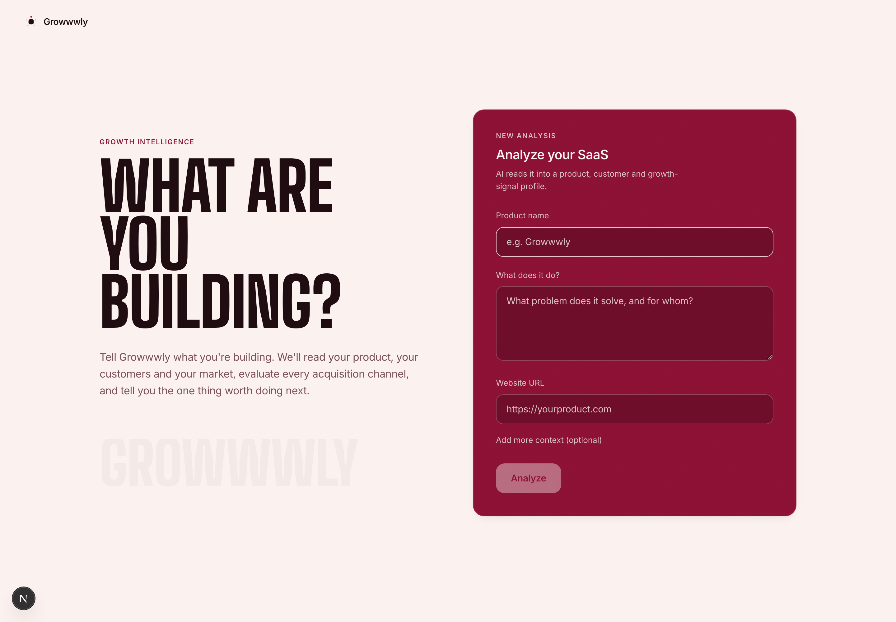
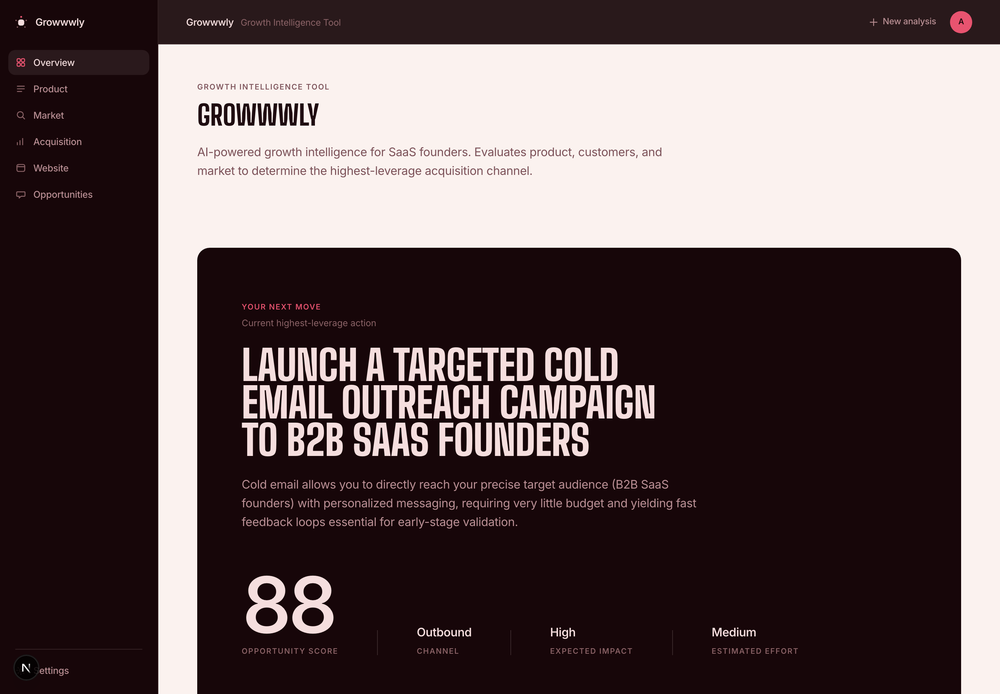
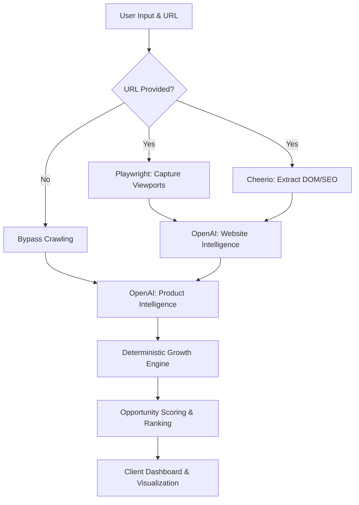

<div align="center">

# Growwwly

**AI-Powered SaaS Growth Intelligence**

Growwwly evaluates your product, your customers, and your market, to determine the single most effective acquisition channel for your business.

[](https://nextjs.org/)
[](https://www.typescriptlang.org/)
[](https://playwright.dev/)
[](https://openai.com/)

</div>

---

## 📸 Screenshots

<table>
  <tr>
    <td width="50%" align="center">
      <strong>Landing & Configuration</strong><br/><br/>
      <br/><br/>
      <em>The main interface for entering product details and starting the analysis.</em>
    </td>
    <td width="50%" align="center">
      <strong>Growth Dashboard</strong><br/><br/>
      <br/><br/>
      <em>The primary dashboard displaying the highest-leverage action and opportunity scores.</em>
    </td>
  </tr>
</table>

## 🧩 The Problem

Early-stage founders often struggle to identify the most effective marketing channels for their specific product, leading to:
* **Wasted Budget:** Spending on paid ads or content marketing before achieving product-market fit or having the necessary budget.
* **Analysis Paralysis:** Too many potential growth avenues (SEO, cold email, social, communities) without a clear framework to prioritize them.
* **Misaligned Strategies:** Running a sales-led motion for a low-LTV product, or attempting product-led growth for complex enterprise software.

## 💡 The Solution

Growwwly acts as a programmatic growth marketer. By combining explicit user input with automated website crawling and AI-driven analysis, it evaluates your SaaS across multiple dimensions (product, market, constraints) and applies a deterministic scoring engine to recommend the highest-leverage acquisition channel for your current stage.

## ✨ Features

| Feature | Description |
|---|---|
| 🤖 **AI-Powered Profiling** | Uses OpenAI to extract structured intelligence from product descriptions and website context. |
| 🌐 **Headless Website Crawling** | Integrates Playwright to capture actual desktop/mobile visual evidence and Cheerio for objective DOM extraction. |
| ⚡ **Performance & SEO Diagnostics** | Utilizes Lighthouse integration and custom extractors to evaluate technical marketing readiness. |
| 📊 **Deterministic Growth Engine** | Ranks 8+ acquisition channels (Outbound, SEO, Paid, etc.) based on an algorithm processing AI signals. |
| 📉 **Graceful Degradation** | Handles serverless sandbox constraints safely—if headless Chromium fails, analysis falls back to user input gracefully. |
| 📄 **PDF Report Generation** | Automatically compiles intelligence into a downloadable, professional PDF report via `@react-pdf/renderer`. |

## ⚙️ How It Works



## 🏗 Architecture

Growwwly is built around a hybrid AI-deterministic pipeline:

1.  **Frontend (Next.js App Router):** Manages a multi-phase animated loading state while streaming responses. Uses React 19 and Tailwind CSS v4 for a highly polished, heavily-animated UI via Framer Motion.
2.  **State Management (React Context):** Session persistence handles storing complex AI responses across page reloads while actively stripping massive base64 image strings to respect `sessionStorage` quota limits.
3.  **Website Extraction (`lib/website`):** A headless Playwright instance runs securely, gathering visual data and rendering screenshots, while Cheerio handles objective SEO data scraping. URL safety checks protect against SSRF.
4.  **AI Providers (`lib/ai`):** Constructs highly specific prompt chains relying on structured outputs (JSON Schemas) from OpenAI to interpret subjective product signals.
5.  **Growth Core (`lib/growth`):** The actual decision-making layer is *not* LLM-based. It is a deterministic, math-driven engine that takes the AI's interpreted signals (e.g., budget constraint = low, target = enterprise) and calculates opportunity scores for various channels.

## 🛠 Tech Stack

| Layer | Technology |
|---|---|
| **Framework** | Next.js 16.3.4 (App Router), React 19 |
| **Language** | TypeScript 5 |
| **Styling** | Tailwind CSS v4 |
| **Animations** | Framer Motion |
| **Web Crawling** | Playwright (Screenshots), Cheerio (DOM) |
| **Performance Tools** | Lighthouse |
| **AI Inference** | OpenAI Node SDK |
| **Schema Validation**| Zod |
| **Testing** | Vitest |

## 📂 Folder Structure

```text
src/
├── app/                  # Next.js App Router (Pages, Layouts, API routes)
│   ├── analyze/          # Entry form and active analysis loading state
│   ├── app/              # Main application dashboard and detailed tabs
│   └── api/              # Serverless API endpoints for AI execution
├── components/           # Reusable UI primitives and section components
├── data/                 # Static growth parameters and definitions
├── growthcore/           # Animated SVG UI components for loading states
├── lib/                  # Core business logic
│   ├── ai/               # OpenAI provider configuration and prompt schemas
│   ├── growth/           # Deterministic growth scoring engine
│   └── website/          # Playwright crawling, Cheerio extraction, Lighthouse
└── types/                # Strict TypeScript definitions for internal data flow
```

## 🧠 Important Technical Subsystems

### Website Extraction Engine
The `lib/website/browser.ts` module dynamically loads Playwright to avoid crashing serverless environments that lack Chromium binaries. It features deep defensive programming: safe URL validation against SSRF, custom wait strategies for marketing site entrance animations, and fallback mechanisms that ensure the broader AI analysis succeeds even if screenshots fail.

### Session Storage Quota Management
Desktop and mobile JPEG screenshots can easily exceed the 5MB `sessionStorage` limit. Growwwly implements intelligent stripping (`lib/analysis-store.tsx`): visual base64 data remains in active React memory for the current session, but is cleanly stripped before local persistence, preventing `QuotaExceededError` crashes while maintaining the core analysis data upon refresh.

### Deterministic Growth Engine
Rather than relying on LLMs for final strategy recommendations (which often result in generic, hallucinatory advice), Growwwly uses AI solely as a *parser* of subjective signals (e.g., determining if a product is "high LTV"). These structured signals are fed into a deterministic TypeScript scoring algorithm (`lib/growth/`) that calculates an absolute "Opportunity Score" for each channel based on real-world constraints.

## 🚀 Installation and Local Development

1. **Prerequisites:** Ensure you have Node.js 20+ installed.
2. **Clone and Install:**
   ```bash
   git clone <repository-url>
   cd Growwwly
   npm install
   ```
3. **Environment Configuration:**
   Copy the example environment file and add your OpenAI key:
   ```bash
   cp .env.local.example .env.local
   ```
   Add your API key:
   ```env
   OPENAI_API_KEY="sk-..."
   ```
4. **Run the Development Server:**
   ```bash
   npm run dev
   ```
5. **Access the App:** Open `http://localhost:3000` in your browser.

## 🔐 Environment Variables

| Variable | Required | Description | Exposed to Client |
|---|---|---|---|
| `OPENAI_API_KEY` | Yes | Valid OpenAI API key for AI pipeline execution. | No (Server-only) |

> **Warning:** Never commit your `.env.local` file or expose your OpenAI API key in client-side code.

## 🛡 Performance, Security, and Reliability

* **SSRF Protection:** Strict URL validation prevents the headless browser from accessing internal network endpoints or malicious addresses.
* **Graceful Degradation:** Heavy reliance on try/catch blocks in the crawler. If a site is broken, slow, or blocks bots, the pipeline degrades to user-input-only analysis without fatal errors.
* **Client-Side Navigation:** Employs Next.js prefetching and local state to make transitions between dashboard panels (Overview, Acquisition, Market) instantaneous.

## 🔮 Future Roadmap

* **Persistent Storage (Phase 2):** Migration from client-side `sessionStorage` to a dedicated backend database (e.g., PostgreSQL/Supabase) to save, share, and track historical analyses.
* **Continuous Monitoring:** Scheduled recurring checks to detect when a product's market positioning or SEO signals shift over time.
* **Competitor Benchmarking:** Running the analysis pipeline against a provided competitor URL for comparative growth scoring.

## 📄 License & Acknowledgements

This project uses modern web standards and relies heavily on the open-source community, particularly the teams behind Next.js, Playwright, and Tailwind CSS.
